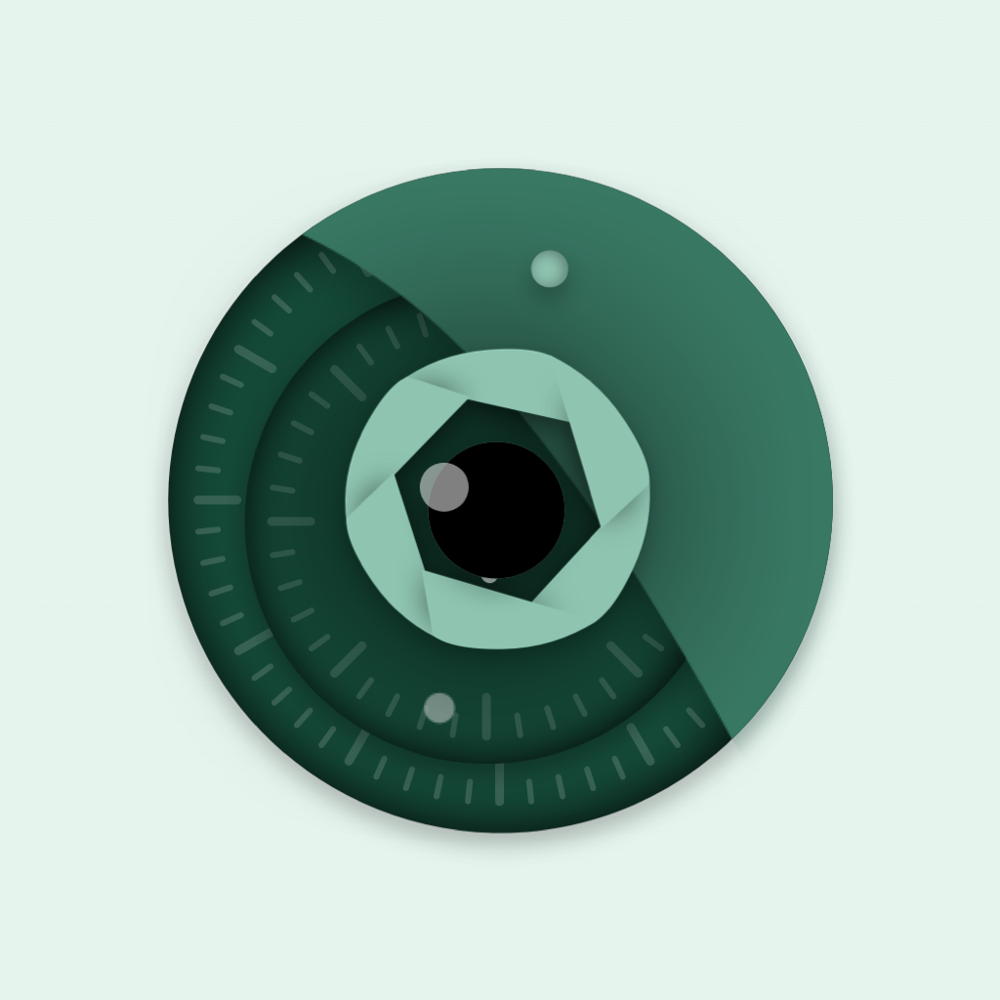
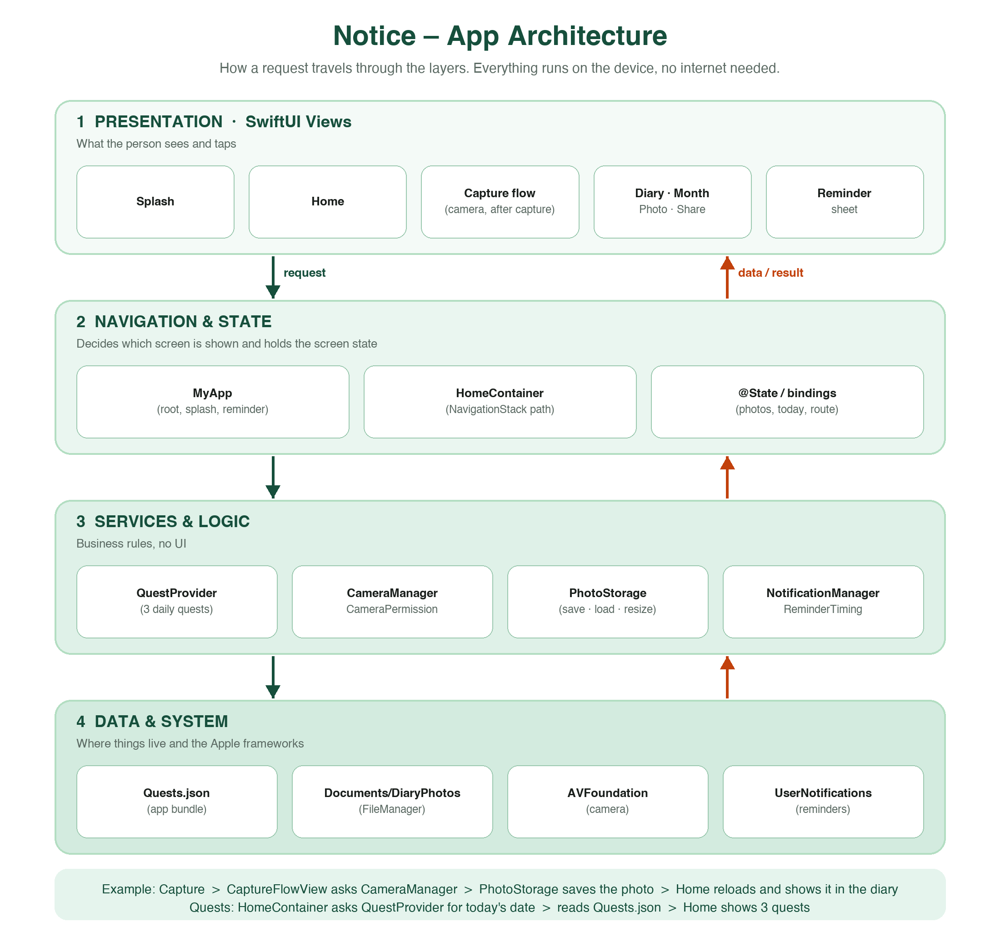

# Notice

<p align="center">
  
</p>

**Notice** is a small iOS app that helps you slow down and look at the world around you.
Every day it gives you **three quests**, one from each category (for example *"Find something orange"*).
You take a photo for each quest, and the photos collect in a personal **diary** you can browse by year and month, open, and share.

Everything works **offline**. Quests are chosen on the phone from the date, and photos never leave the device.

## Features

- **Three daily quests**: one per category, the same for the whole day, new ones every day.
- **Capture**: built-in camera with zoom, camera flip, and a review step (*Retake* or *Save to diary*).
- **Diary**: today's and yesterday's photos on Home, plus *See all* to browse by year > month > photo.
- **Share**: share a photo, save it to the Photos library, or delete it.
- **Gentle reminders**: after finishing all quests the app offers a daily reminder notification.
- **Responsive layout**: adapts to small and large iPhones and to iPad (centered column, adaptive grids, scrolls on short screens).

## Architecture



The app is split into four layers. A request goes **down** (a tap becomes a call to a service) and the result comes back **up** (data updates the state, and SwiftUI redraws).

| Layer | What it does | Files |
| --- | --- | --- |
| **1. Presentation** | SwiftUI screens the person sees and taps | `Views/Home`, `Views/Camera`, `Views/Diary`, `Views/Splash` |
| **2. Navigation & State** | Chooses the screen and holds screen state | `MyApp`, `HomeContainer` (`NavigationStack`), `@State` |
| **3. Services & Logic** | Rules with no UI | `QuestProvider`, `CameraManager`, `CameraPermission`, `PhotoStorage`, `NotificationManager`, `ReminderTiming` |
| **4. Data & System** | Storage and Apple frameworks | `Quests.json`, `Documents/DiaryPhotos`, AVFoundation, UserNotifications |

A more detailed look at how quests are picked is in [`docs/QuestArchitecture.html`](docs/QuestArchitecture.html).

## Project structure

```
MyApp/      App entry point, assets, fonts, Quests.json
Models/     Quest, notification and reminder logic
Views/
  Home/     Home screen and its components
  Camera/   Camera, capture flow, photo storage
  Diary/    Diary, month, photo details, share
  Design/   Colors, typography, responsive helpers
  Splash/   Launch animation
```

## Requirements

- Xcode (latest) and an iOS 26+ device or simulator
- Open `Notice.xcodeproj` and run the **Notice** scheme

## Built by

This project was built by **Bassant, Aseel, Rifal, Layan, and Hind**, developers at the **Apple Developer Academy**.
